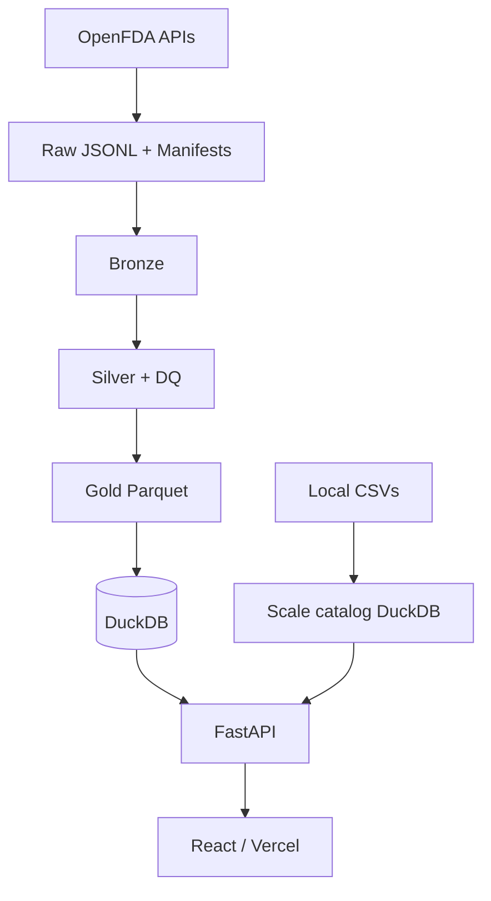

# PharmaScope

Enterprise-oriented **pharmaceutical data intelligence** platform for ingesting
official public medicine datasets, validating quality, and producing reproducible
statistical and exploratory safety analytics.

## Live demo

**Vercel:** [https://pharmascope-peach.vercel.app](https://pharmascope-peach.vercel.app)

Alternate URL: [https://pharmascope-alirazach476.vercel.app](https://pharmascope-alirazach476.vercel.app)

> Production uses a static API snapshot (pre-aggregated 50M-scale marts + searchable
> samples including `Pakistan_medicines.csv` and `medicine_dataset.csv`). The full
> DuckDB/FastAPI backend runs locally.

> **Disclaimer:** PharmaScope is an analytical research tool — **not** a validated
> clinical decision-support system. Adverse-event reports do **not** prove that a
> medicine caused an event. Reporting Odds Ratios are exploratory signals only.

## Business problem

Analysts need a trustworthy way to answer questions about medicine products,
reported adverse events, recalls, and (when configured) utilization — with
lineage from KPI → transformation → source, and without fabricated metrics.

## Main use cases

1. Bounded, reproducible OpenFDA extraction with manifests  
2. Medallion processing (raw → bronze → silver → gold)  
3. Data-quality reports with severity-based promotion rules  
4. Exploratory disproportionality (ROR) with explicit limitations  
5. React dashboard + FastAPI access to warehouse / scale catalog  

## Architecture

See [docs/architecture.md](docs/architecture.md) for diagrams and grain definitions.



## Data sources

| Source | Status | Docs |
|--------|--------|------|
| OpenFDA Drug Events | Enabled | https://open.fda.gov/apis/drug/event/ |
| OpenFDA NDC | Enabled | https://open.fda.gov/apis/drug/ndc/ |
| OpenFDA Enforcement | Enabled | https://open.fda.gov/apis/drug/enforcement/ |
| `medicine_dataset.csv` | Ingested (50k) | Project root / `data/raw/local_datasets/` |
| `Pakistan_medicines.csv` | Ingested (~19k) | Project root / `data/raw/local_datasets/` |
| DailyMed | Disabled until verified | https://dailymed.nlm.nih.gov/ |
| CMS Part D | Disabled until verified | https://data.cms.gov/ |

Details: [docs/data_sources.md](docs/data_sources.md)

## Technology stack

Python 3.12 · httpx · pydantic · pandas · PyArrow · DuckDB · scipy/statsmodels/scikit-learn · FastAPI · React (Vite) · Recharts · Streamlit · pytest · ruff

## Installation

### Windows PowerShell

```powershell
cd "C:\Users\DELL\Downloads\Pakistan Pharmacy Anaylsis"
python -m venv .venv
.\.venv\Scripts\Activate.ps1
python -m pip install -U pip
python -m pip install -e ".[dev]"
copy .env.example .env
pytest -q
```

### Linux / macOS

```bash
python -m venv .venv
source .venv/bin/activate
python -m pip install -U pip
python -m pip install -e ".[dev]"
cp .env.example .env
pytest -q
```

## Environment

Copy `.env.example` → `.env`. Important variables:

- `PHARMASCOPE_DEV_RECORD_LIMIT` (default 1000) — caps sample downloads  
- `PHARMASCOPE_ALLOW_FULL_DOWNLOAD=false` — must be true for large extracts  
- `OPENFDA_API_KEY` — optional  
- `DUCKDB_PATH` — analytical warehouse file  

## Data download (bounded sample)

```powershell
python scripts/download_data.py --source openfda_events --limit 200
python scripts/download_data.py --source openfda_ndc --limit 200
python scripts/download_data.py --source openfda_recalls --limit 200
```

Or all OpenFDA sources:

```powershell
python scripts/run_ingestion.py --all --limit 200
```

## Transformations & warehouse

```powershell
python scripts/run_transformations.py --source openfda_events
python scripts/run_transformations.py --source openfda_ndc
python scripts/run_transformations.py --source openfda_recalls
python scripts/initialize_warehouse.py
python scripts/run_analytics.py
```

## React dashboard (primary UI)

```powershell
# Terminal 1 — API
$env:PYTHONPATH = "src"
uvicorn pharmascope.api.main:app --host 127.0.0.1 --port 8001

# Terminal 2 — React
cd web
npm install
npm run dev
```

Open http://127.0.0.1:5173

### Scale catalog (50M labeled medicines)

```powershell
python scripts/generate_synthetic_medicines.py --target 50000000 --skip-parquet
python scripts/ingest_local_medicine_csvs.py
python scripts/export_vercel_static_api.py
```

### Deploy frontend to Vercel

```powershell
cd web
vercel --prod
```

## Streamlit dashboard (legacy)

```powershell
streamlit run src/pharmascope/dashboard/app.py
```

## API

```powershell
uvicorn pharmascope.api.main:app --reload --port 8001
```

OpenAPI docs: http://127.0.0.1:8001/docs

## Testing

```powershell
pytest -q
```

## Documentation index

| Doc | Path |
|-----|------|
| Implementation plan | [docs/implementation_plan.md](docs/implementation_plan.md) |
| Project status | [docs/project_status.md](docs/project_status.md) |
| Architecture | [docs/architecture.md](docs/architecture.md) |
| Statistical methodology | [docs/statistical_methodology.md](docs/statistical_methodology.md) |
| Data governance | [docs/data_governance.md](docs/data_governance.md) |

## Known limitations

- OpenFDA API pagination `skip` max 25,000 — use bulk downloads for larger corpora  
- Full 50M DuckDB catalog is local-only (not hosted on Vercel)  
- DailyMed / CMS analytics not enabled until sources verified  
- Entity resolution is identifier/name-first; fuzzy matches require manual review  

## License

MIT — see [LICENSE](LICENSE). Respect upstream OpenFDA / NLM / CMS terms when using data.
