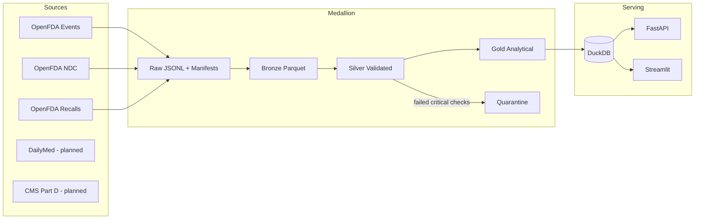

# PharmaScope Architecture

## Overview

PharmaScope is a local-first pharmaceutical data intelligence platform that ingests
**official public** datasets, preserves provenance, validates quality, and serves
analytical outputs through DuckDB, a FastAPI API, and a Streamlit dashboard.

## Design principles

1. **Authentic data only** in analytical layers; synthetic fixtures are isolated.
2. **Bounded downloads by default** (`PHARMASCOPE_DEV_RECORD_LIMIT`).
3. **Separate fact grains** — never explode multi-drug/multi-event reports into a single counted mega-table without an explicit bridge table.
4. **Statistical humility** — FAERS counts are reported cases; ROR is exploratory.
5. **Reproducibility** — every extraction writes a manifest with checksums and parameters.

## Fact table grains

| Table | Grain | Key |
|-------|-------|-----|
| `fact_adverse_event_reports` | One row per safety report per batch | `safetyreportid`, `batch_id` |
| `dim_reported_drugs` | One row per drug within a report | `safetyreportid`, `drug_index` |
| `dim_reported_reactions` | One row per reaction within a report | `safetyreportid`, `event_index` |
| `fact_reported_drug_events` | Drug×event pairs for association analysis | `safetyreportid`, `drug_index`, `event_index` |
| `fact_recalls` | One recall record | `recall_number`, `batch_id` |
| `dim_medicine_ndc` | One NDC product | `product_ndc`, `batch_id` |

## Runtime components

| Component | Role |
|-----------|------|
| `scripts/download_data.py` | Bounded API extraction |
| `scripts/run_transformations.py` | Bronze→silver→gold |
| `scripts/run_analytics.py` | Warehouse summaries |
| `pharmascope.api.main` | HTTP API |
| `pharmascope.dashboard.app` | Interactive UI |
| `pharmascope.cli` | Typer CLI (`run-slice`, `download`, `transform`) |

## Non-goals (current version)

- Clinical decision support
- Causal inference from spontaneous reports
- Unbounded multi-GB downloads without explicit opt-in
- Claiming cloud production deployment without configuration evidence
